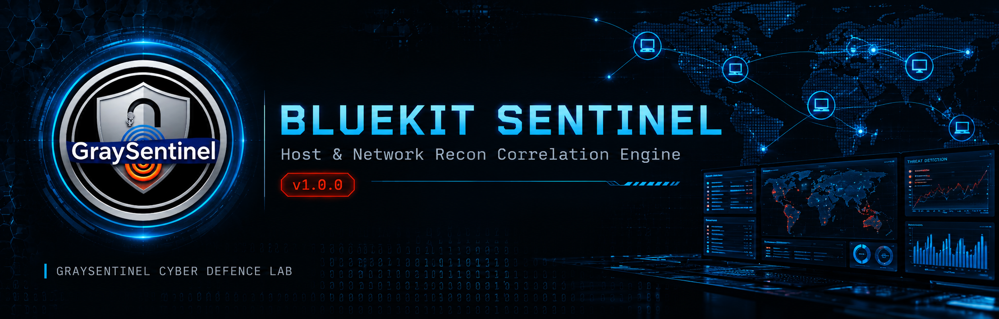

<div align="center">
  
</div>

<br/>

# 🛡️ BlueKit Sentinel v1.0.0

> **Host & Network Recon Correlation Engine**
> *Graysentinel Cyber Defence Lab · by Ritik Shrivas*

[](LICENSE)
[](https://www.python.org/)
[]()
[]()
[](SECURITY.md)

---

## ⚠️ Authorized Use Only

This is a **defensive security tool** intended for authorized environments only.

**You must have explicit written authorization** to run this tool against any
system you do not personally own. Unauthorized scanning, packet capture, or
credential-pattern detection may violate computer fraud laws in your jurisdiction.

Graysentinel Cyber Defence Lab accepts **no liability** for misuse.

📖 Read the full [Security Policy](SECURITY.md) before use.

---

## 📑 Table of Contents

- [Overview](#-overview)
- [Features](#-features)
- [Architecture](#-architecture)
- [Installation](#-installation)
- [Quick Start](#-quick-start)
- [CLI Reference](#-cli-reference)
- [Web Dashboard](#-web-dashboard)
- [Detection Capabilities](#-detection-capabilities)
- [Algorithms](#-algorithms)
- [Data Storage](#-data-storage)
- [Configuration](#-configuration)
- [Known Limitations](#-known-limitations)
- [FAQ](#-faq)
- [Contributing](#-contributing)
- [License](#-license)
- [Contact](#-contact)

---

## 🔍 Overview

**BlueKit Sentinel** is a host and network reconnaissance correlation engine
built for **blue teams, incident responders, and security researchers**.

It correlates:

- **Process behavior** (command lines, entropy, parent/child relationships)
- **Live TCP/UDP connections** (with PID attribution when privileged)
- **MITRE ATT&CK technique matches** (100+ detection patterns)
- **Persistence artifacts** (cron, systemd, SUID, LD_PRELOAD, SSH keys)
- **Network telemetry** (DNS, TLS/SNI, JA3, HTTP)
- **Authentication events** (SSH, sudo — from `/var/log/auth.log`)
- **File integrity** (SHA256 baseline of critical system files)
- **C2 beaconing patterns** (statistical CV + FFT regularity)

...into a **ranked, auditable finding list** with confidence scores,
Bayesian posteriors, and a persistent triage workflow.

### Design Philosophy

| Principle | Implementation |
|---|---|
| **Graceful degradation** | Every subsystem has a fallback; no single failure kills the tool |
| **Auditable** | Every suppression and alert decision is logged with reasoning |
| **Bounded** | All caches, queues, and lists have hard size limits |
| **Thread-safe** | Documented lock scope; no shared mutable state without guards |
| **Zero false confidence** | Bayesian scoring penalizes low-signal detections |

---

## ✨ Features

### 🎯 Detection Engine

- **100+ MITRE ATT&CK patterns** — Embedded regexes for T1059, T1003, T1547, T1105, T1486, and more
- **Bayesian confidence scoring** — `P(malicious | signals)` with calibrated likelihood ratios
- **EMA adaptive anomalies** — Per-key EWMA z-score for traffic volume spikes
- **SYN/ACK statistical port-scan detection** — Distinguishes scans from legit traffic
- **C2 beacon detection** — Coefficient of variation + FFT peak ratio on inter-arrival times
- **Process risk graph** — Propagates risk from high-risk children up to parents
- **Shannon entropy analysis** — Flags high-entropy (encoded) command lines
- **Jaccard baseline drift** — Detects processes/connections absent from learned baseline

### 🌐 Network Telemetry

- **DNS query logging** — Every DNS query with source, timestamp, type
- **TLS SNI extraction** — Reveals hostname requested inside encrypted traffic
- **JA3 TLS fingerprinting** — Client TLS library identification
- **HTTP request capture** — Method, host, path, user-agent for plain HTTP
- **DGA domain detection** — Entropy + vowel ratio + digit ratio heuristics
- **Typosquat detection** — Levenshtein distance from known brands
- **DNS tunneling heuristics** — Long-label + high-entropy + query frequency

### 🛡️ Endpoint Integrity

- **SHA256 file baseline** — `/etc/passwd`, `/etc/shadow`, `/etc/sudoers`, and more
- **Service monitoring** — Detects new/removed systemd services
- **Auth log parsing** — SSH failed/success, sudo events
- **Brute-force detection** — Sliding window per source IP
- **Password spray detection** — Distinct users per source IP
- **SUID binary scanning** — Non-standard SUID binaries in temp dirs
- **LD_PRELOAD detection** — Rootkit indicator
- **SSH authorized_keys audit** — Count of non-comment keys per user

### 🧭 Workflow & Operations

- **Alert triage** — Analyst status, notes, history — SQLite persisted
- **Suppression engine** — Conservative rules with full audit trail
- **Stable finding IDs** — `GS-XXXX` format based on content hash
- **Baseline learning** — `scan --baseline learn` then compare
- **Historical snapshots** — SQLite snapshots + findings history
- **JSON export** — Machine-readable scan reports
- **REST API** — `/api/snapshot`, `/api/findings`, `/api/history`

### 🚀 Production Features

- **Waitress WSGI server** — Production-grade, no dev-server warnings
- **Optional Gunicorn + TLS** — For remote bind
- **CSRF protection** — All POST requests
- **CSP headers** — Strict Content-Security-Policy
- **Basic auth** — For remote bind (requires `--auth-token`)
- **Session cookie security** — HTTPOnly, SameSite=Strict

---

## 🏗️ Architecture

```
┌──────────────────────────────────────────────────────────────────┐
│                        BlueKit Sentinel                          │
├──────────────────────────────────────────────────────────────────┤
│                                                                  │
│   ┌─────────────┐   ┌─────────────┐   ┌─────────────┐            │
│   │   Host      │   │  Network    │   │ Persistence │            │
│   │  Collector  │   │  Collector  │   │  Auditor    │            │
│   └──────┬──────┘   └──────┬──────┘   └──────┬──────┘            │
│          │                 │                 │                   │
│          └─────────┬───────┴─────────────────┘                   │
│                    ▼                                             │
│         ┌──────────────────────────┐                             │
│         │  Correlation Engine      │                             │
│         │  ┌───────────────────┐   │                             │
│         │  │ Bayesian Scorer   │   │                             │
│         │  │ EMA Anomaly       │   │                             │
│         │  │ Port Scan         │   │                             │
│         │  │ Beacon Detector   │   │                             │
│         │  │ Risk Graph        │   │                             │
│         │  │ Suppression       │   │                             │
│         │  └───────────────────┘   │                             │
│         └────────────┬─────────────┘                             │
│                      ▼                                           │
│         ┌──────────────────────────┐                             │
│         │  Findings (ranked)       │                             │
│         │  + SQLite persistence    │                             │
│         │  + Triage workflow       │                             │
│         └────────────┬─────────────┘                             │
│                      ▼                                           │
│    ┌─────────────┬────────────┬──────────────┐                   │
│    │  CLI Output │  JSON      │  Flask Web   │                   │
│    │             │  Report    │  Dashboard   │                   │
│    └─────────────┴────────────┴──────────────┘                   │
│                                                                  │
├──────────────────────────────────────────────────────────────────┤
│  Optional: Packet Capture Engine (Scapy)                         │
│  ┌──────────────────┐    ┌────────────────────────┐              │
│  │ Flow tracking    │    │ Telemetry parser       │              │
│  │ (main queue)     │    │ (extra queue, async)   │              │
│  └──────────────────┘    │ → DNS, TLS/SNI, HTTP   │              │
│                          └────────────────────────┘              │
└──────────────────────────────────────────────────────────────────┘
```

**Key design decisions:**

- **Two-queue packet processing** — Main flow queue + separate telemetry queue, so
  expensive TLS parsing never blocks flow tracking.
- **Batch DB writes** — Telemetry flushes every 2 seconds, not per packet.
- **Lazy telemetry** — Expensive operations (FIM, auth) opt-in only via `run_expensive=True`.
- **Per-table schema migrations** — Old DBs upgrade without data loss.
- **Independent module fallbacks** — Scapy DNS not available? Everything else still works.

---

## 📦 Installation

### Requirements

- **Python 3.9+**
- **Root/sudo** (recommended for full PID attribution, FIM, and auth log access)

### From Source

```bash
git clone https://github.com/YOUR_USERNAME/bluekit-sentinel.git
cd bluekit-sentinel

python3 -m venv .venv
source .venv/bin/activate  # Windows: .venv\Scripts\activate

pip install --upgrade pip
pip install -r requirements.txt
```

### Dependencies

| Package | Purpose | Required |
|---|---|---|
| `psutil` | Process/connection/network data | **Yes** |
| `rich` | Terminal formatting | No (graceful fallback) |
| `flask` | Web dashboard | No (web command needs it) |
| `waitress` | Production WSGI server | No (web command needs it) |
| `gunicorn` | TLS server | No (only for `--tls-cert`) |
| `numpy` | Beacon FFT analysis | No (beacon detection disabled without it) |
| `scapy` | Packet capture | No (only `--pcap` needs it) |
| `PyYAML` | YAML allowlist parsing | No (JSON works without it) |

### Docker (Optional)

```bash
docker build -t bluekit-sentinel .
docker run --rm -it --net=host --pid=host --privileged \
    -v ~/.bluekit:/root/.bluekit \
    bluekit-sentinel scan -v
```

---

## 🚀 Quick Start

### 1. Basic scan

```bash
sudo python3 bluekit_sentinel.py scan -v
```

Sample output:

```
╭──────────────── GRAYSENTINEL CYBER DEFENCE LAB ────────────────╮
│ HOST  kali (kali.local)                                        │
│ Linux 6.5.0 · Privileged: yes                                  │
│ Connections: 47 | External: 8 | Processes: 235                 │
│ Findings: 3 | Critical: 0 | High: 1                            │
╰────────────────────────────────────────────────────────────────╯

⚠️  3 Finding(s)

High      GS-A3F9B2E1  ATT&CK: PowerShell
   PID 12345 (pwsh) matched T1059.001. Bayesian posterior=91.2%.
   · P(malicious|signals)=0.912
   · signals=external_connection,encoded_command,high_entropy_cmd
   · T1059.001: -enc SQBFAFgAIAAoAE4AZQB3AC0ATwBiAGoA
   → T1059.001
```

### 2. Continuous watch

```bash
sudo python3 bluekit_sentinel.py watch --interval 30 --count 0
```

### 3. Web dashboard

```bash
sudo python3 bluekit_sentinel.py web --port 8080
```

Open: **http://127.0.0.1:8080**

### 4. Web + packet capture

```bash
sudo python3 bluekit_sentinel.py web --pcap eth0 --port 8080
```

### 5. Baseline learning

```bash
# Learn for 1-2 hours of normal activity
sudo python3 bluekit_sentinel.py watch --baseline learn --interval 60 --count 60

# Then run scan with baseline comparison
sudo python3 bluekit_sentinel.py scan --baseline ~/.bluekit/sentinel/baseline.json
```

### 6. JSON export

```bash
sudo python3 bluekit_sentinel.py scan --json report.json
```

---

## 🖥️ CLI Reference

### Commands

| Command | Purpose |
|---|---|
| `scan` | One-shot scan |
| `watch` | Continuous monitoring |
| `web` | Flask web dashboard |
| `history` | Snapshot + finding history |
| `persist-audit` | Audit persistence mechanisms |

### Common Flags

| Flag | Applies to | Purpose |
|---|---|---|
| `--quiet` | All | Hide banner/footer |
| `--allowlist PATH` | scan, watch, web | Suppression allowlist |
| `--baseline PATH_OR_LEARN` | scan, watch | Baseline file or 'learn' |
| `--min-confidence {low,medium,high}` | scan, watch | Filter findings |
| `--json PATH` | scan, persist-audit | Write JSON report |

### Scan Flags

| Flag | Purpose |
|---|---|
| `--no-processes` | Skip process scan (faster) |
| `--no-save` | Don't persist to history |
| `--verbose / -v` | Detailed output |
| `--pcap IFACE` | Enable packet capture |
| `--bpf FILTER` | BPF filter (default: `ip or ip6`) |

### Watch Flags

| Flag | Purpose |
|---|---|
| `--interval SEC` | Seconds between scans (default: 15) |
| `--count N` | Stop after N scans (0 = infinite) |
| `--pcap IFACE` | Enable packet capture |

### Web Flags

| Flag | Purpose |
|---|---|
| `--host ADDR` | Bind address (default: 127.0.0.1) |
| `--port PORT` | Bind port (default: 8080) |
| `--pcap IFACE` | Enable packet capture |
| `--auth-token TOKEN` | Required for non-loopback binds (≥24 chars) |
| `--tls-cert PATH` | TLS certificate (required with --tls-key) |
| `--tls-key PATH` | TLS private key |

### Exit Codes

| Code | Meaning |
|---|---|
| `0` | Clean — no high/critical findings |
| `1` | High-severity findings present |
| `2` | Critical-severity findings present |
| `130` | Interrupted by user (Ctrl+C) |

---

## 🌐 Web Dashboard

Open `http://127.0.0.1:8080` after running `web` command.

| Route | Description |
|---|---|
| `/` | Overview — host info, stats, top findings |
| `/connections` | Live TCP/UDP connections with PID attribution |
| `/processes` | All processes with ATT&CK matches |
| `/network` | Interfaces, routes, ARP |
| `/findings` | Full finding list with evidence |
| `/dns` | Recent DNS queries + DGA + typosquats |
| `/tls` | TLS sessions with SNI + JA3 |
| `/auth` | Brute force + password spray detections |
| `/integrity` | File integrity changes |
| `/triage` | Analyst triage workflow |
| `/suppressions` | Suppression audit trail |
| `/beacons` | Statistical beacon candidates |
| `/pcap` | Live packet flows |
| `/history` | Snapshot + finding history |

### API Endpoints

| Endpoint | Method | Returns |
|---|---|---|
| `/api/snapshot` | GET | Full current snapshot (JSON) |
| `/api/findings` | GET | Findings + stats |
| `/api/history` | GET | Last 200 snapshots |

### Remote Deployment (TLS + Auth)

```bash
# Generate self-signed cert (or use Let's Encrypt)
openssl req -x509 -newkey rsa:4096 -nodes \
    -keyout key.pem -out cert.pem -days 365 \
    -subj "/CN=sentinel.local"

# Start with auth + TLS
python3 bluekit_sentinel.py web \
    --host 0.0.0.0 --port 8443 \
    --auth-token "$(openssl rand -hex 32)" \
    --tls-cert cert.pem \
    --tls-key key.pem
```

> ⚠️ **Remote bind REQUIRES** `--auth-token` (≥24 chars) + TLS. The tool **refuses**
> to bind to non-loopback without these.

---

## 🎯 Detection Capabilities

### ATT&CK Techniques Detected

| Tactic | Techniques |
|---|---|
| **Reconnaissance** | T1595, T1595.001, T1595.002 |
| **Execution** | T1059, T1059.001, T1059.003, T1059.004, T1059.006 |
| **Persistence** | T1547, T1547.001, T1543.002, T1543.003, T1546.003, T1546.004, T1546.008, T1505.003 |
| **Privilege Escalation** | T1548, T1548.001, T1548.002, T1068 |
| **Defense Evasion** | T1055, T1055.012, T1140, T1027, T1070, T1070.001, T1070.003, T1036, T1218, T1218.005, T1218.010, T1218.011, T1564, T1564.003, T1574.006, T1553.002 |
| **Credential Access** | T1110, T1110.002, T1552.001, T1552.003, T1552.004, T1552.005, T1003, T1003.001, T1003.008, T1555.003, T1557, T1557.002, T1558, T1558.003, T1040 |
| **Discovery** | T1087, T1087.001, T1083, T1046, T1057, T1082, T1016, T1018, T1033, T1518.001 |
| **Lateral Movement** | T1021.001, T1021.002, T1021.004, T1021.006, T1570, T1550.002, T1550.003 |
| **Collection** | T1005, T1560.001, T1114.003 |
| **Command & Control** | T1071, T1071.004, T1105, T1572, T1090, T1219, T1102 |
| **Exfiltration** | T1041, T1567.002, T1567.003, T1048, T1048.003 |
| **Impact** | T1485, T1486, T1490, T1489, T1496, T1498.001, T1531, T1529 |
| **Defense Impairment** | T1685, T1686, T1686.003, T1112 |

### Critical Techniques (Cannot Be Suppressed)

```
T1003.*  — Credential dumping
T1055.*  — Process injection
T1218.*  — System binary proxy execution
T1485    — Data destruction
T1486    — Ransomware encryption
T1490    — Inhibit recovery
T1547.*  — Boot/logon autostart
T1558.*  — Kerberos tickets
T1053.005 — Scheduled task
```

### High-Risk Command Patterns (Always Alert)

```
-enc / -EncodedCommand    PowerShell encoded
frombase64string          PowerShell decoding
downloadstring            PowerShell download cradle
invoke-mimikatz           Credential dumping
sekurlsa                  LSASS memory access
vssadmin delete shadows   Ransomware precursor
/dev/tcp/                 Bash reverse shell
nc -e / ncat -e           Netcat reverse shell
memfd_create              Fileless execution
LD_PRELOAD                Library hijacking
curl | sh / wget | sh     Download-and-execute
sudo bash/sh/zsh          Privilege escalation
```

---

## 🧮 Algorithms

### 1. Bayesian Confidence Scoring

```
Prior odds:      O_prior = P(malicious) / (1 − P(malicious))
                       = 0.05 / 0.95 ≈ 0.0526

Per-signal:      LR_i = P(signal_i | malicious) / P(signal_i | benign)

Posterior odds:  O_post = O_prior × Π(LR_i)

Posterior prob:  P(malicious | signals) = O_post / (1 + O_post)
```

**Likelihood ratio examples:**

| Signal | LR | Effect |
|---|---|---|
| `external_connection` | 4.0 | Moderate |
| `suspicious_port` | 8.0 | Strong |
| `beacon_pattern` | 15.0 | Very strong |
| `credential_access` | 20.0 | Extreme |
| Unknown signal | 1.0 | Neutral (no info) |

**Confidence mapping:**
- `P ≥ 0.85` → High
- `P ≥ 0.55` → Medium
- else → Low

### 2. Shannon Entropy

```
H(X) = −Σ p(x) · log₂ p(x)
```

| Range | Interpretation |
|---|---|
| 0.0 – 3.5 | Plaintext, natural language |
| 3.5 – 4.5 | Encoded but low-entropy |
| 4.5 – 6.0 | Base64, obfuscated |
| 6.0 – 8.0 | Encrypted, random bytes |

Threshold for "suspicious command line": `H > 4.8 bits/char`

### 3. EMA Adaptive Anomaly

```
ema_t   = α · x_t + (1 − α) · ema_{t-1}
var_t   = α · (x_t − ema_{t-1})² + (1 − α) · var_{t-1}
σ_t     = √var_t
z_t     = (x_t − ema_t) / σ_t
```

Alert when `|z_t| > threshold` (default 3.5) after 10+ observations.

Default `α = 0.3` — adapts to changes in ~3-10 observations.

### 4. Port Scan Detection

```
probability = 0.6 · min(ports_scanned / 100, 1.0)
            + 0.4 · (1 − completion_ratio)

where completion_ratio = ack_count / syn_count (capped to [0,1])
```

Threshold: `probability ≥ 0.5` → scan alert.

A legitimate server has high completion. A scan has low completion.

### 5. Beacon Detection

```
intervals = [t_i − t_{i-1}]  for i = 1..n
CV        = σ(intervals) / μ(intervals)         ← lower = more periodic
FFT_reg   = max(Power(FFT(intervals))) / ΣPower  ← higher = more periodic

If CV ≤ 0.35 AND FFT_reg ≥ 0.55:
    confidence = (1 − min(CV, 1)) · 0.5 + FFT_reg · 0.5
```

Requires ≥8 events to same destination.

### 6. Jaccard Baseline Drift

```
J(A, B) = |A ∩ B| / |A ∪ B|
```

- `J = 1.0` — identical to baseline
- `J < 0.5` — significant drift (alerts)

Applied separately to process identities and connection identities.

### 7. Process Risk Propagation

```
risk[parent] = max(base_risk[parent],
                   max(risk[child] · decay for child in children))
```

Iterate to fixpoint (max 5 iterations). `decay = 0.6` default.

Rationale: A parent that spawns a high-risk child is itself complicit.

### 8. DGA Domain Detection

```
score = 0
if entropy(label) > 3.8:      score += 0.35
if entropy(label) > 4.2:      score += 0.15
if vowel_ratio < 0.25:        score += 0.25
if digit_ratio > 0.20:        score += 0.15
if len(label) > 16:           score += 0.10

is_dga = score ≥ 0.55
```

### 9. CUSUM Change Point

```
S⁺_i = max(0, S⁺_{i-1} + z_i − k)     ← detects upward shifts
S⁻_i = min(0, S⁻_{i-1} + z_i + k)     ← detects downward shifts
```

Change detected when `|S| > threshold` (default 5.0).

---

## 💾 Data Storage

### Directory Structure

```
~/.bluekit/
└── sentinel/
    ├── sentinel.db               # SQLite: snapshots, findings, triage, telemetry
    ├── enterprise-attack.json    # ATT&CK STIX cache (optional)
    ├── allowlist.yaml            # User suppression rules
    └── baseline.json             # Learned baseline
```

**Permissions**: `0o700` on directory, `0o600` on files.

### SQLite Schema

**Main tables:**

| Table | Purpose |
|---|---|
| `snapshots` | Full JSON payload per scan |
| `findings` | Individual findings (normalized) |
| `triage_records` | Analyst status per finding |
| `triage_history` | Audit log of triage changes |

**Telemetry tables:**

| Table | Purpose |
|---|---|
| `dns_queries` | DNS query log |
| `tls_sessions` | TLS SNI + JA3 |
| `http_requests` | Plain HTTP requests |
| `domain_intel` | Domain reputation + DGA flags |
| `file_integrity` | SHA256 baseline of critical files |
| `service_state` | systemd service snapshot |
| `auth_events` | SSH/sudo events |

### Retention

- **Snapshots**: Last 500 (auto-pruned)
- **Findings**: Linked to snapshots (auto-pruned)
- **DNS/TLS/HTTP**: Last 50,000 each (auto-pruned)
- **Triage history**: Last 10,000 (auto-pruned)

### Backup

```bash
# Backup everything
tar -czf sentinel-backup-$(date +%Y%m%d).tar.gz ~/.bluekit/

# Restore
tar -xzf sentinel-backup-*.tar.gz -C ~/
```

### Schema Migration

On startup, the tool checks for missing columns and `ALTER TABLE`s them in.
This means **old databases are automatically upgraded** without data loss.

---

## ⚙️ Configuration

### Environment Variables

| Variable | Default | Purpose |
|---|---|---|
| `BLUEKIT_HOME` | `~/.bluekit` | Data directory |
| `BLUEKIT_LOG_LEVEL` | `WARNING` | Logging level |

### Suppression Allowlist (`~/.bluekit/sentinel/allowlist.yaml`)

```yaml
rules:
  - name: my-internal-scanner
    pattern: "(?i)scan-tool.*--internal"
    techniques: [T1595, T1046]
    reason: "Authorized internal scanner"

  - name: backup-agent
    pattern: "(?i)backup-agent.*--file"
    techniques: [T1005]
    reason: "Known backup daemon"
```

**Rules apply only when:**
1. Technique matches the rule's `techniques` list
2. Command line matches the `pattern`
3. Technique is NOT in `CRITICAL_TECHNIQUES`
4. Command does NOT match `HIGH_RISK_OVERRIDE`

Every suppression is logged to `suppression_audit` for review.

### Baseline JSON Format

```json
{
  "schema_version": 2,
  "processes": {
    "bash:/bin/bash": {
      "count": 47,
      "first_seen": "2025-01-15T10:30:00Z",
      "last_seen": "2025-01-15T18:45:00Z"
    }
  },
  "connections": {
    "chrome:12345:142.250.185.78:443": {
      "count": 23,
      "first_seen": "2025-01-15T10:31:00Z",
      "last_seen": "2025-01-15T18:44:00Z"
    }
  },
  "scans": 60,
  "last_scan": "2025-01-15T18:45:00Z"
}
```

---

## ⚠️ Known Limitations

### Environment Limitations

| Limitation | Reason | Workaround |
|---|---|---|
| PCAP requires root | AF_PACKET needs `CAP_NET_RAW` | `sudo` |
| FIM needs root | Reading `/etc/shadow` needs root | `sudo` |
| Auth log needs root | `/var/log/auth.log` is `0o640` | `sudo` or add user to `adm` group |
| PID attribution needs privilege | `psutil.net_connections` restricted | `sudo` or `CAP_NET_ADMIN` |

### Technical Limitations

| Limitation | Description |
|---|---|
| **ESNI/ECH** | TLS SNI hidden for Encrypted Client Hello — no extraction possible |
| **HTTP/2, HTTP/3** | Only HTTP/1.1 currently parsed |
| **Encrypted DNS** | DoH/DoT queries not visible (only on-path plaintext) |
| **TLS 1.3 with SSU** | Some ESNI variants may hide SNI |
| **QUIC** | UDP/443 QUIC not parsed (would need separate parser) |
| **Windows partial** | No `/proc`, no SUID, no cron — features limited |
| **macOS partial** | `log show` not yet parsed for auth events |

### Windows Support

Windows runs but with reduced capabilities:

- ✅ Process enumeration (via psutil)
- ✅ Connection enumeration
- ✅ Persistence (registry Run keys, services)
- ✅ ATT&CK pattern matching
- ❌ SUID scan (POSIX only)
- ❌ Cron audit (POSIX only)
- ❌ `/var/log/auth.log` (POSIX only)
- ❌ `/etc/shadow` FIM (POSIX only)

### Performance Characteristics

| Operation | Typical time | Notes |
|---|---|---|
| Basic `scan` | 1-3s | ~200 processes, ~50 connections |
| `scan --pcap eth0` | 3-5s | + packet capture setup |
| Web dashboard first load | 3-8s | Telemetry + snapshot |
| Web dashboard cached | 100-300ms | 3s TTL |
| Baseline diff | 200-500ms | JSON load + compare |

---

## ❓ FAQ

### **Q: Do I need root to use this?**

**A:** No. The tool runs without root, but with reduced visibility:
- No PID→process attribution for connections
- No FIM (can't read `/etc/shadow`)
- No auth monitoring
- No packet capture

For full functionality: `sudo`.

### **Q: Is this safe to run on production?**

**A:** Yes — it's read-only. No modifications are made to the system.
But it DOES capture traffic (`--pcap`), so check your organization's policy.

### **Q: Can I use it on Windows?**

**A:** Yes, but with reduced features (see [Known Limitations](#-known-limitations)).
Windows-native features (registry, WMI) are not yet fully implemented.

### **Q: How do I update ATT&CK patterns?**

**A:** Embedded patterns are in the source. MITRE STIX refresh happens
automatically every 7 days if network is available. Manual refresh is not exposed
in v1.0.0 (planned for v1.1).

### **Q: Why are certain findings suppressed?**

**A:** Run `scan -v` and check `suppression_audit` in output or via web
`/suppressions` page. Every suppression is logged with rule name and reason.

### **Q: Can I whitelist a false positive?**

**A:** Yes — edit `~/.bluekit/sentinel/allowlist.yaml`:

```yaml
rules:
  - name: my-fp
    pattern: "(?i)my-application.*--known-flag"
    techniques: [T1059]
    reason: "Legitimate use of command-line tool"
```

**But**: `CRITICAL_TECHNIQUES` (like T1003) can never be suppressed.

### **Q: How do I uninstall?**

**A:**

```bash
rm -rf ~/.bluekit/
pip uninstall psutil rich flask waitress numpy scapy pyyaml
rm bluekit_sentinel.py
```

### **Q: Where is data stored?**

**A:** `~/.bluekit/sentinel/sentinel.db` (SQLite). Everything is local — no
cloud sync, no telemetry to external services.

---

## 🤝 Contributing

Contributions welcome! Please:

1. **Open an issue** first to discuss significant changes
2. **Fork** and create a feature branch
3. **Test** your changes:
   ```bash
   python3 -m py_compile bluekit_sentinel.py
   sudo python3 bluekit_sentinel.py scan
   sudo python3 bluekit_sentinel.py web --port 8080
   ```
4. **Commit** with clear messages (`feat:`, `fix:`, `docs:`)
5. **Submit** a pull request

### Commit Message Convention

```
feat: add new ATT&CK detection for T1234
fix: resolve DB migration on old schema
docs: update README installation section
refactor: simplify port-scan detection logic
perf: reduce snapshot collection time by 30%
test: add unit tests for BayesianScorer
chore: update requirements.txt
```

### Code Style

- **PEP 8** formatting
- **Type hints** on new functions
- **Docstrings** on public functions
- **Bounded** any new caches/queues
- **Thread-safe** any new shared state

### Security

**DO NOT** open public issues for security vulnerabilities.
Email **graysentinel.ai@gmail.com** instead.

---

## 📄 License

**Apache License 2.0** — see [LICENSE](LICENSE) for full text.

```
Copyright 2025 Ritik Shrivas / Graysentinel Cyber Defence Lab

Licensed under the Apache License, Version 2.0 (the "License");
you may not use this file except in compliance with the License.
You may obtain a copy of the License at

    http://www.apache.org/licenses/LICENSE-2.0

Unless required by applicable law or agreed to in writing, software
distributed under the License is distributed on an "AS IS" BASIS,
WITHOUT WARRANTIES OR CONDITIONS OF ANY KIND, either express or implied.
See the License for the specific language governing permissions and
limitations under the License.
```

---

## 📞 Contact

**Graysentinel Cyber Defence Lab**

| Channel | Link |
|---|---|
| 🌐 Website | [cyberdefencelab.co.in](https://cyberdefencelab.co.in) |
| 📧 Email | [graysentinel.ai@gmail.com](mailto:graysentinel.ai@gmail.com) |
| 💼 Founder | [linkedin.com/in/ritikshrivas312](https://linkedin.com/in/ritikshrivas312) |
| 📸 Instagram | [@graysentinel](https://instagram.com/graysentinel) |
| 🔗 LinkedIn | [Graysentinel OSINT](https://linkedin.com/company/graysentinel-osint) |

---

## 🌟 Acknowledgments

- **MITRE ATT&CK®** — Framework and technique definitions
- **psutil** — Cross-platform process/network data
- **Scapy** — Packet capture and protocol parsing
- **Flask** — Web framework
- **Rich** — Terminal formatting

---

<div align="center">

**[⬆ Back to Top](#️-bluekit-sentinel-v100)**

**Built with 🛡️ by [Graysentinel Cyber Defence Lab](https://cyberdefencelab.co.in)**

*Authorized use only. See [SECURITY.md](SECURITY.md).*

</div>
